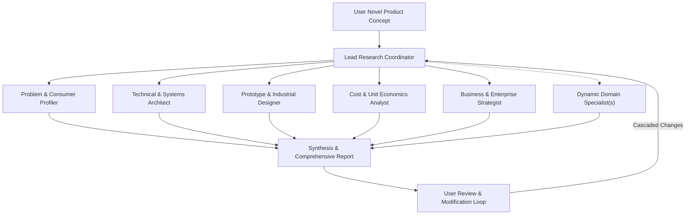

# Autonomous Multi-Agent Research Team Skill

This skill transforms Antigravity into a hierarchical research lab that takes any raw or speculative concept—even products that have never existed before—and conducts rigorous, comprehensive research from first principles.

## Workflow Pipeline

### Stage 1: Conceptual Triage & Dynamic Agent Spawning
The Lead Coordinator analyzes the input topic and dynamically creates the required specialist sub-agents. It determines:
* How many sub-agents are needed for this specific topic.
* What specialist domains are required (e.g. Optics, Quantum, Biotech, Consumer Electronics, Logistics).
* What deliverables each sub-agent owns.

---

### Stage 2: Sub-Agent Responsibilities

#### 1. Problem & Consumer Profiler
* **Core Problem Statement**: What fundamental limitation or friction does this solve?
* **Consumer Persona**: Who are the primary consumers and enterprise buyers?
* **Willingness to Pay**: Behavioral incentives and adoption barriers.

#### 2. Technical & Systems Architect
* **Feasibility Analysis**: Physical, chemical, or computational laws governing the product.
* **Component Breakdown**: Microcontrollers, sensors, materials, APIs, neural models, power budgets.
* **Failure Modes**: Critical engineering bottlenecks and fallback mechanisms.

#### 3. Prototype & Industrial Designer
* **Visual Schematics**: High-contrast Mermaid architecture diagrams, physical layout maps, and UI/UX flows.
* **Form Factor & Ergonomics**: Dimensions, materials (e.g. anodized aluminum, titanium, bio-resins), and touchpoints.
* **Image Prompt Generation**: Precise prompts for visual rendering of the prototype.

#### 4. Cost & Unit Economics Analyst
* **BOM (Bill of Materials)**: Estimated component-level costs for a single unit.
* **Prototyping Budget**: Estimated R&D, tooling, and MVP validation expenses.
* **Scale Pricing**: Projected unit manufacturing cost at 1K, 10K, and 100K units, suggested retail price (MSRP), and gross margins.

#### 5. Business & Strategy Architect
* **Company Profile**: What type of company builds this (deep tech startup, OEM partnership, SaaS+Hardware)?
* **Go-To-Market**: Distribution, launch wedge, developer ecosystem.
* **Regulatory & IP**: Patents, safety standards (FCC, CE, FDA, ISO), and legal considerations.

---

### Stage 3: Synthesis & Report Generation
The Coordinator aggregates all sub-agent findings into a structured report containing:
1. **Executive Verdict & Summary**: Concise decision-maker takeaway.
2. **Problem & Consumer Profile**: Demographics, addressable market, and target audience.
3. **Engineering Blueprint & Tech Stack**: Feasibility and component specs.
4. **Interactive Visual Diagram / Prototype**: Mermaid layout and visual architecture.
5. **Detailed Cost Breakdown**: R&D, BOM, and retail economics table.
6. **Go-To-Market & Moat Strategy**: Execution path and risks.

---

### Stage 4: Bidirectional Modification Loop
When the user requests adjustments (e.g. *"Make it pocket-sized"*, *"Change target from B2C to enterprise hospitals"*, or *"Reduce the BOM cost under $100"*):
1. The Lead Coordinator notifies all affected subsidiaries of the constraint change.
2. The Engineering and Cost agents recalculate specs and pricing.
3. The Consumer and Strategy agents update personas and GTM.
4. An updated revision is generated without losing context.
