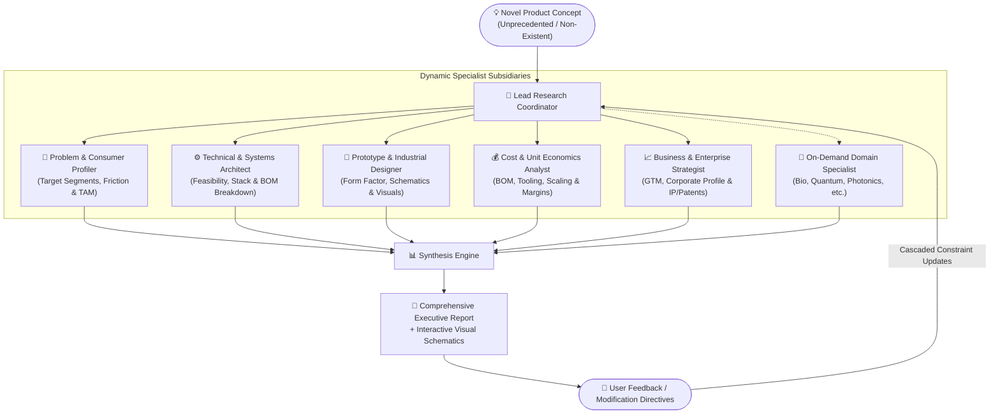

# 🔬 Autonomous Research Team Agent

> **Hierarchical multi-agent framework designed to conduct rigorous, end-to-end research on novel, hypothetical, and unprecedented product concepts from first principles.**

[](https://opensource.org/licenses/MIT)
[](https://deepmind.google)
[](#architecture)

---

## 🌟 Overview

The **Autonomous Research Team Agent** is an agentic framework built for entrepreneurs, R&D labs, and inventors. When given an idea for a product that **does not yet exist in the world**, the system does not hallucinate or stop at high-level summaries. Instead, a **Lead Research Coordinator** dynamically spins up specialized domain sub-agents (subsidiaries) that collaboratively research:

1. **Problem & Consumer Profiler**: Pinpoints real user friction, demographic profiles, consumer willingness to pay, and target buyer personas.
2. **Technical & Systems Architect**: Evaluates scientific feasibility, materials science, hardware/software specifications, and component dependencies.
3. **Prototype & Industrial Designer**: Produces physical dimensions, ergonomic touchpoints, visual architecture, and UI/UX schematics.
4. **Cost & Unit Economics Analyst**: Generates Bill of Materials (BOM), prototyping budgets, volume scaling economics (1k, 10k, 100k units), and gross margin projections.
5. **Business & Enterprise Strategist**: Maps corporate structure, competitive moats, Go-To-Market (GTM) distribution channels, and regulatory/patent barriers (FCC, FDA, CE, ISO).
6. **Dynamic Domain Specialists**: Automatically instantiated for niche domains (e.g., Nanotechnology, Optics, Quantum Mechanics, Bio-safety).

---

## 🏗️ Architecture & Workflow



---

## 🔄 Bidirectional Modification Loop

The system features a **synchronized modification loop**:
* If you tell the coordinator: *"Make it pocket-sized"*, *"Change target from B2C to enterprise hospitals"*, or *"Keep unit BOM under $50"*:
* The **Lead Coordinator** cascades the revised constraints across all subsidiaries.
* **Engineering & Cost** recalculate components, power draw, and supplier pricing.
* **Consumer & Strategy** recalculate market sizing and distribution channels.
* The synthesized report and diagrams update dynamically without losing prior context.

---

## 📁 Repository Structure

```text
research-team/
├── AGENTS.md                          # Primary agent behavioral rules & coordinator protocol
├── README.md                          # Repository documentation & architecture guide
├── LICENSE                            # MIT License
└── .agents/
    └── skills/
        └── research-team/
            └── SKILL.md               # Antigravity skill definition & dynamic subagent schema
```

---

## 🚀 Getting Started

### In Google Antigravity
1. Clone this repository or open its folder:
   ```bash
   git clone https://github.com/harshith1432/research-team-agent.git
   ```
2. Open the directory in Antigravity.
3. The platform automatically detects [AGENTS.md](file:///D:/projects%20softwares/research%20team/AGENTS.md) and registers the `research-team` skill.
4. Simply prompt the agent with any concept:
   > *"Research a non-invasive continuous blood glucose monitoring wristband using photonic spectroscopy that requires no needles and zero calibration."*

---

## 📄 License

This project is licensed under the [MIT License](LICENSE).
